# cmr

> **<u>c</u>ommand line <u>m</u>arkdown <u>r</u>enderer**

## about

cmr is a simple markdown rendering library for terminal output. Currently, it
parses the following markdown syntax:

- headings
- lists
- tables
- quotes
- bold & italic text
- links
- code blocks
- inline code

## installation

    cargo add cmr

## usage

### rendering

To render markdown with `cmr`, you:

- call `cmr::parse()` on some markdown text to produce a `Document`
- call `Document::render()` to produce a `Page`
- print the `Page`

```rust
const MARKDOWN: &str = r"## this is a header

this is a paragraph with **bold**, *italic* and `inline code` in it

- this is a list
- with another item";

fn main() {
    let document = cmr::parse(MARKDOWN);
    let page = document.render();
    println!("{page}");
}
```

`Document::render()` uses the default `Format`, which is 80 columns wide:

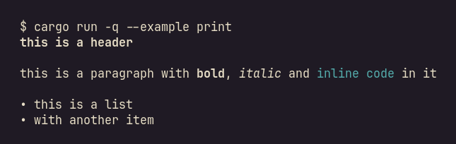

### rendering with a custom `Format`

You can instead call `Document::render_with()` to produce a custom formatted
`Page`:

```rust
use cmr::Format;

const MARKDOWN: &str = r"## this is a header

this is a paragraph with **bold** and *italic* text, wrapped at forty columns

- this is a list
- with another item";

fn main() {
    let format = Format::builder().width(40).build();
    let document = cmr::parse(MARKDOWN);
    let page = document.render_with(format);
    println!("{page}");
}
```

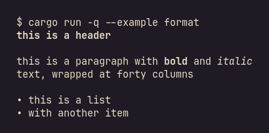

### Pages are made up of `Row`s

`Page::rows()` produces a slice of `Row`s. Every `Row` in a page is the same
width, so they are easy to "draw" around. For example, you could draw a border
around them:

```rust
use cmr::Format;

const MARKDOWN: &str = r"## this is a header

this is a paragraph with **bold** and *italic* text, wrapped to fit inside the frame

- this is a list
- with another item";

fn main() {
    let format = Format::builder().width(40).build();
    let page = cmr::parse(MARKDOWN).render_with(format);

    println!("┌{}┐", "─".repeat(42));
    for row in page.rows() {
        println!("│ {row} │");
    }
    println!("└{}┘", "─".repeat(42));
}
```

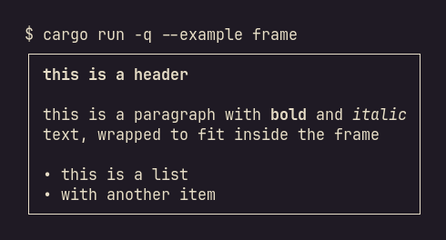

### a `Row` is a `String` and a `Style`

A `Row` is made up of a list of `(String, Style)` pieces, which are the
primitive building blocks that `cmr` renders. If you want to implement your
own rendering logic, you can access those pieces directly:

```rust
const MARKDOWN: &str = r"## this is a header

this is a paragraph with **bold** and *italic* text in it";

fn main() {
    let page = cmr::parse(MARKDOWN).render();
    for row in page.rows() {
        for (text, style) in &row.pieces {
            let mut codes = Vec::new();
            if style.bold {
                codes.push("1;36");
            }
            if style.italic {
                codes.push("3;31");
            }
            print!("\x1b[{}m{text}\x1b[0m", codes.join(";"));
        }
        println!();
    }
}
```

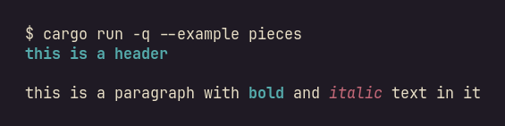

### using `cmr` in a TUI

You can also use `cmr` to render markdown in your favorite TUI framework. For
example, in [ratatui](https://ratatui.rs):

```rust
use cmr::Format;
use ratatui::crossterm::event;
use ratatui::layout::Rect;
use ratatui::style::{Modifier, Style};
use ratatui::text::{Line, Span};
use ratatui::widgets::{Block, Paragraph};

const MARKDOWN: &str = r"## this is a header

this is a paragraph with **bold** and *italic* text in it

- this is a list
- with another item";

fn line(row: &cmr::Row) -> Line<'static> {
    let spans = row.pieces.iter().map(|(text, style)| {
        let mut out = Style::new();
        if style.bold {
            out = out.add_modifier(Modifier::BOLD);
        }
        if style.italic {
            out = out.add_modifier(Modifier::ITALIC);
        }
        Span::styled(text.clone(), out)
    });
    Line::from_iter(spans)
}

fn main() -> std::io::Result<()> {
    let page = cmr::parse(MARKDOWN).render_with(Format::builder().width(30).build());
    let lines: Vec<Line> = page.rows().iter().map(line).collect();

    let mut terminal = ratatui::init();
    terminal.draw(|frame| {
        let area = Rect::new(0, 0, 34, lines.len() as u16 + 2);
        let block = Block::bordered().title(" cmr in ratatui ");
        frame.render_widget(Paragraph::new(lines.clone()).block(block), area);
    })?;
    event::read()?;
    ratatui::restore();
    Ok(())
}
```

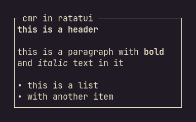

The rest of the API is documented on [docs.rs](https://docs.rs/cmr).

## rendered examples

These screenshots come from running the `render` example on the markdown
files in `examples/`.

### headers and text

```markdown
# this is a header

This is a paragraph with **bold text**, *italic text*, `inline code` and
[a link](https://example.com).

## this is a smaller header

### this is an even smaller header

#### this is the smallest header
```

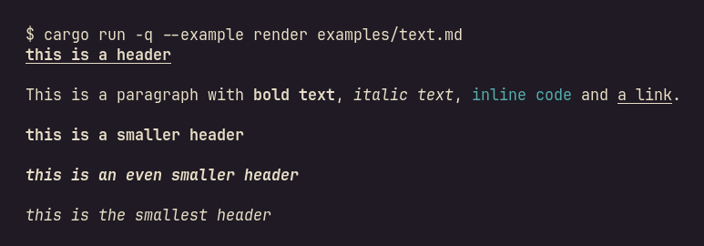

### lists

```markdown
- this is a list
- with another item
  - blah blah blah
    - blah blah

1. this is a numbered list
2. with a second item
3. and a third
```

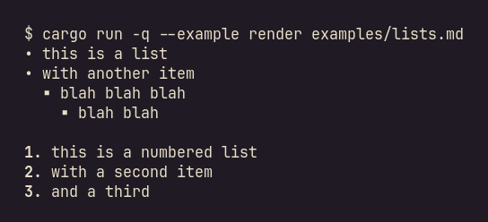

### quotes and rules

```markdown
> this is a quote with **bold** and `code` in it
>
> - and a list inside it

---

> this is a quote after a rule
```

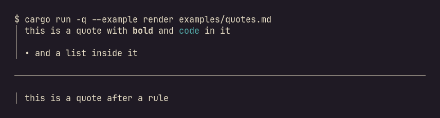

### code blocks

````markdown
```rust
// this is a comment
fn example() {
    let number = 42;
    let text = "this is a string";
}
```
````

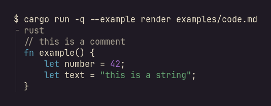

### tables

```markdown
| this is a column | another column | a third |
|---|---|---|
| a | b | c |
| blah | blah | blah |
| 1 | 2 | 3 |
```

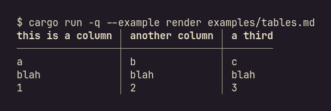

### side by side

The `columns` example puts the rows of several pages side by side:

````rust
use cmr::Format;

const TOP: &str = r"# this is a header

this is a paragraph that runs across the full width, above both of the columns";

const LEFT: &str = r"this is a paragraph with **bold** and *italic* text in it

- this is a list
- with another item
  - blah blah blah";

const RIGHT: &str = r"this is a paragraph with `inline code` and [a link](https://example.com)

1. this is a numbered list
2. with a second item
3. and a third";

const BOTTOM: &str = r#"```rust
// this is a code block under both of the columns
let text = "this is a string";
```"#;

fn main() {
    let full = Format::builder().width(63).build();
    let column = Format::builder().width(30).height(6).build();
    let rule = "─".repeat(63);

    println!("{}", cmr::parse(TOP).render_with(full));
    println!("{rule}");
    let left = cmr::parse(LEFT).render_with(column);
    let right = cmr::parse(RIGHT).render_with(column);
    for (l, r) in left.rows().iter().zip(right.rows()) {
        println!("{l} │ {r}");
    }
    println!("{rule}");
    println!("{}", cmr::parse(BOTTOM).render_with(full));
}
````

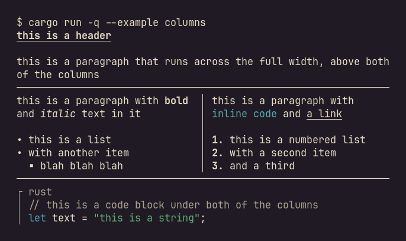

## license

Licensed under either of

- Apache License, Version 2.0 ([LICENSE-APACHE](LICENSE-APACHE) or
  <http://www.apache.org/licenses/LICENSE-2.0>)
- MIT license ([LICENSE-MIT](LICENSE-MIT) or
  <http://opensource.org/licenses/MIT>)

at your option.

Unless you explicitly state otherwise, any contribution intentionally submitted
for inclusion in the work by you, as defined in the Apache-2.0 license, shall be
dual licensed as above, without any additional terms or conditions.
